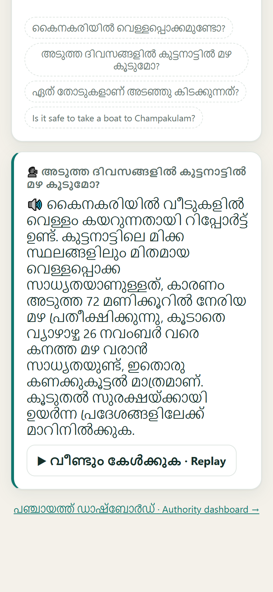
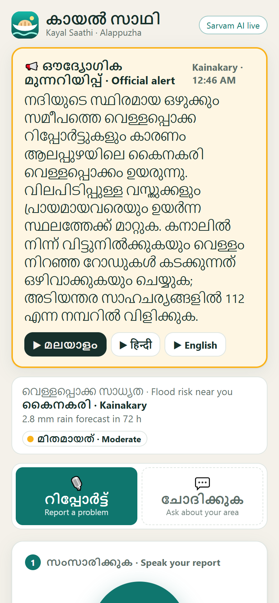
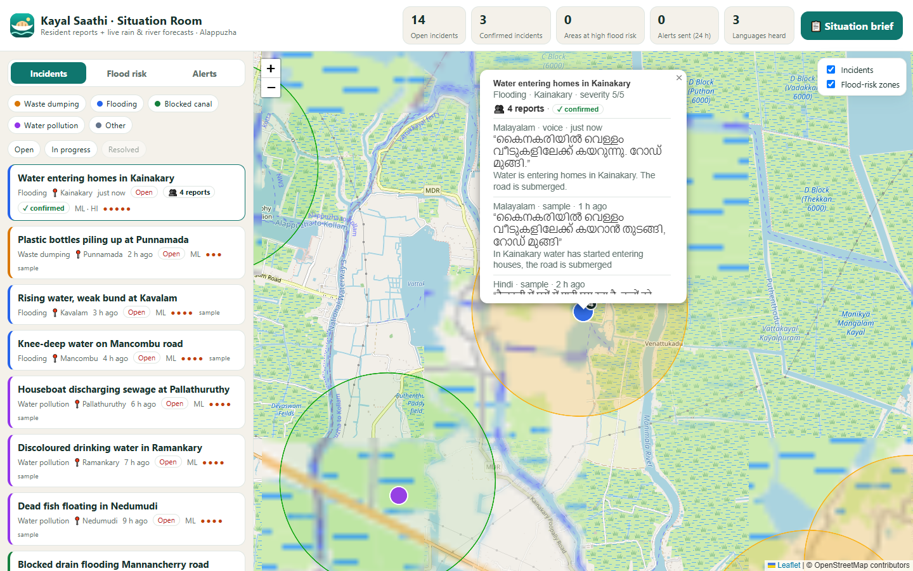
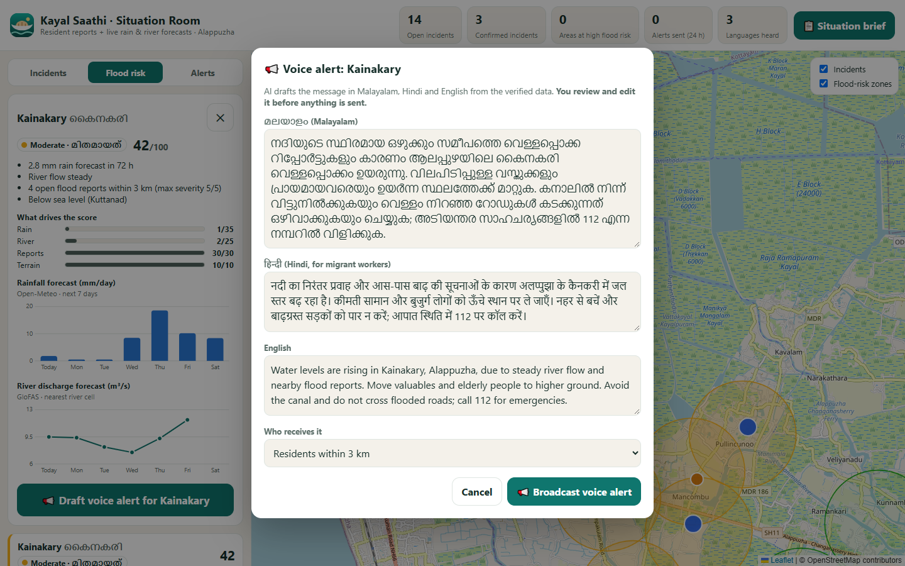
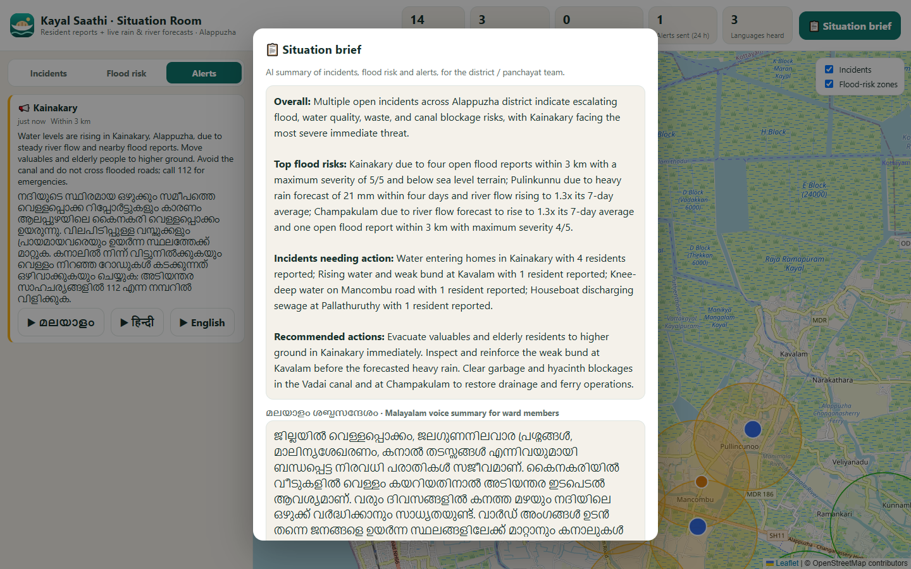
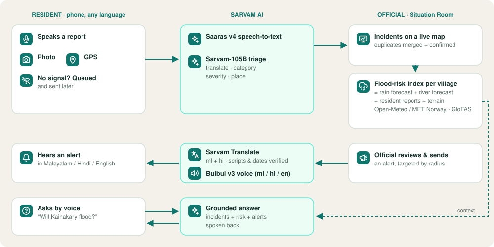

# കായൽ സാഥി · Kayal Saathi

**A voice-first flood and backwater situation room for Alappuzha. Residents report in Malayalam (or Hindi, Tamil, English) by voice. AI combines their reports with live rain and river forecasts. Officials send verified voice alerts back to residents' phones in their own language.**

 **Live demo: https://kayal-saathi.onrender.com** · Situation Room: https://kayal-saathi.onrender.com/dashboard · Source: https://github.com/hemanthbs54/kayal_Saathi

Built solo for **HackaThoni 2026: The Houseboat Hackathon** (Alappuzha, 21–22 Nov).
Primary track: **02 Beyond English (Sarvam)**. It also covers **01 The Alappuzha Challenge** (floods, backwater waste, livelihoods) and **03 Beyond the Screen** (voice, camera, GPS, offline).

<p align="center">
  
</p>

## See it working

All screenshots below are from the real app running with the **live Sarvam AI**: real Malayalam speech, real translations, real forecasts. Nothing is mocked up.

### Resident app (phone)

| 1 · Home | 2 · Speak a report | 3 · Ask by voice |
|:---:|:---:|:---:|
|  |  |  |
| Flood risk for *your* village, numbered steps, one big mic | Malayalam speech → transcript, English translation, category, severity, merged with 3 earlier reports | "Will rain increase in Kuttanad?" → spoken Malayalam answer from the live forecast |

| 4 · Receives an official alert | 5 · No signal on the boat |
|:---:|:---:|
|  |  |
| Plays in Malayalam; one tap for Hindi or English | Report saved on the phone, sent automatically when signal returns |

### Situation Room (officials)

**Incidents:** duplicate reports merged; each shows every resident's words in their own language.


**Flood risk:** an explainable 0–100 score per village, built from live rain + river forecasts, reports and terrain.


**Voice alert:** AI drafts it, Sarvam Translate makes Malayalam + Hindi, and the official reviews it before sending.


**Situation brief:** one click gives an English brief for the district team and a Malayalam voice summary for ward members.


| Phone layout | Dark mode |
|:---:|:---:|
|  |  |

---

## The problem

Much of Kuttanad is farmed **below sea level** behind earthen bunds. When rain and rising rivers combine, the first warning signs are seen by residents, fishers and houseboat crews: water entering homes, a weak bund, a canal choked with water hyacinth. Two gaps stop that information from saving anyone:

1. **Up:** reporting means typing in English on a form, so elderly people, low-literacy residents and Hindi-speaking migrant workers mostly don't report.
2. **Down:** official warnings arrive as generic text, not as a voice message in your language about *your* village.

## The loop

 Sarvam Saaras v4 speech-to-text and Sarvam-105B triage -> incidents on a live map and a flood-risk index per village built from rain and river forecasts, resident reports and terrain. The official reviews and sends an alert targeted by radius -> Sarvam Translate and Bulbul v3 voice -> the resident hears it in Malayalam, Hindi or English. A resident asks by voice and gets a grounded spoken answer." />

## Features

| | Feature | Depth |
|---|---|---|
|  | **Voice reporting in any Indian language** | Auto language detection (`saaras:v4`, `language_code=unknown`), Malayalam + English place-name hints, fuzzy matching of misheard village names |
|  | **Flood-risk index for 13 villages (0–100)** | Live **rainfall forecasts** (Open-Meteo, with automatic fallback to **MET Norway**; checked on 21 Nov, the two agreed within 0.1 mm for Kainakary: 25.2 vs 25.3 mm on 25 Nov), **GloFAS river-discharge** forecasts, open flood reports within 3 km (severity- and recency-weighted), and terrain (below-sea-level Kuttanad polders score highest). Every score is **explained** ("25 mm on Wednesday 25 November; river rising to 1.4×; 3 flood reports within 3 km") |
|  | **Incidents, not just pins** | Reports of the same problem within 600 m and 72 h merge into one incident with a confirmation count. 2+ reports or a photo marks it **confirmed**, which cuts duplicates and spam |
|  | **Location-targeted voice alerts** | Official picks an area or incident → AI writes the alert in English from verified facts only → **Sarvam Translate** produces Malayalam + Hindi → official reviews and edits → Bulbul voices all three → phones within the chosen radius show it and play it |
|  | **Ask by voice** | Answers are grounded in incidents, the risk index and active alerts; first-hand reports take priority; spoken back in the asker's language |
|  | **AI situation brief** | One click: English brief for the district team + Malayalam voice summary for ward members |
|  | **Works without signal** | Reports made offline (audio + photo) are stored on the phone (IndexedDB) and sent automatically on reconnect, keeping the original capture time. The app itself opens with no signal (service worker) |
|  | **Photos that just work** | Camera photos are rotated upright, shrunk to ~1280 px and re-encoded as JPEG on the phone. A format the phone can't decode is refused with a clear message instead of being silently dropped |

## Accuracy and safety: measured, not assumed

`npm run eval` runs the real pipeline against Sarvam and prints everything, including back-translations so non-Malayalam speakers can check the output.

| Check | Result |
|---|---|
| 10 spoken reports (7 Malayalam, 1 Hindi, 1 Tamil, 1 English): language, category, place, severity | **10/10** (first version: 7/10; place names were misheard until fixed) |
| Alert scripts: Malayalam in Malayalam script, Hindi in Devanagari | Verified on every draft, and the server refuses to broadcast otherwise |
| Village names in translated alerts | Placeholder protection keeps the official spelling (കൈനകരി / कैनकरी) |
| Dates in translated alerts | Full dates only; a timing check rejects any translation that adds "today/tomorrow" |

Issues the evaluation caught and fixed: an LLM writing Malayalam into the Hindi field (now translated with Sarvam Translate and script-checked), a translator turning "on Wednesday, in 4 days" into "tomorrow, for four days" (now absolute dates, a timing check and a second-model retry), the translator respelling village names (now placeholder-protected), a Q&A answer saying a hyacinth-blocked canal was fine to travel (first-hand incidents now take priority), Hindi rendering "backwater" as पिछवाड़े, which means "backyard" (now a protected glossary term: കായൽ / बैकवाटर), and Malayalam case endings detached from protected names (now joined: കൈനകരി + ൽ → കൈനകരിയിൽ).

**Human in the loop:** the AI never sends anything by itself. Every alert is reviewed and editable before broadcast. The risk index is labelled as an *indicative community index, not an official warning*, and points people to IMD and KSDMA.

## Reliability: what happens when something fails

| Failure | What the app does |
|---|---|
| No mobile signal | Report (voice, photo, GPS) saved on the phone, sent automatically on reconnect with its original time; the app still opens offline |
| Sarvam speech-to-text down | Resident is asked to type instead (clear Malayalam + English message) |
| Sarvam LLM down | The report is still saved, sorted by keyword rules (Malayalam, Hindi, English), so nothing a resident says is lost |
| Translation adds a wrong date or script | Retried with a second Sarvam model; otherwise the official sees a warning, and wrong-script text cannot be broadcast |
| Open-Meteo rate-limited (happens on shared cloud IPs) | Rainfall switches to MET Norway automatically; river data is relayed through the Situation Room browser |
| All weather sources down | Risk still computed from resident reports + terrain; the dashboard shows the data is unavailable |
| One shared venue Wi-Fi | Rate limits are per IP and sized for a crowded room (150 AI requests / 10 min) |

`GET /api/health` reports the deployed repo and commit, AI mode and live Sarvam usage counters.

## Sarvam APIs used

| API | Used for |
|---|---|
| `POST /speech-to-text` · `saaras:v4` | Reports and questions in any Indian language, with keyterms |
| `POST /v1/chat/completions` · `sarvam-105b` (`reasoning_effort: null`) | Triage to JSON, grounded Q&A, alert drafting, situation brief |
| `POST /translate` · `mayura:v1` (fallback `sarvam-translate:v1`) | Alert translation to Malayalam + Hindi |
| `POST /text-to-speech` · `bulbul:v3` | Spoken answers, voice alerts (ml/hi/en), brief audio |

## Tests

```bash
npm test        # 34 unit, API and failure-mode tests, offline (mock mode, no credits)
npm run eval    # live accuracy evaluation against Sarvam (~₹6)
```

A 19-step browser test (Playwright, real Chrome, **live Sarvam AI**) covers: a Malayalam voice report through the real microphone path, photo upload, the offline queue and reconnect, the incident merge, status changes, risk charts, alert draft → edit → broadcast, a resident inside the radius receiving it in Malayalam and Hindi, a resident 20 km away not receiving it, the brief, live fly-to, layer toggles and the mobile layout. **19/19 pass.**

Real output from the final build (unit tests, live browser E2E, live accuracy evaluation):


## Run it

```bash
npm install
cp .env.example .env      # paste SARVAM_API_KEY=...
npm start                 # http://localhost:3000   Situation Room: /dashboard
```

Node 22+. No build step. One Express app with a JSON file store. Weather data needs no key.

> Mic, camera and GPS need HTTPS on phones: use the Render deploy (`render.yaml`) or a tunnel.

## Project layout

```
src/app.js         routes: reports, incidents, risk, alerts, brief, ask (+ per-IP rate limits)
src/sarvam.js      Sarvam client: STT, chat, translate, TTS + usage counters
src/ai.js          triage, grounded Q&A, alert drafting + translation checks, brief
src/risk.js        explainable flood-risk index
src/weather.js     Open-Meteo / MET Norway rain + GloFAS river forecasts (cached, fallback, fail-safe)
src/incidents.js   duplicate-report clustering
src/places.js      Alappuzha gazetteer: coordinates, terrain, ml/hi names, place protection
public/            resident PWA (app.js, offline.js, sw.js) + Situation Room (dashboard.js)
test/              API + unit tests        scripts/eval.mjs   live accuracy evaluation
```

## Credit budget

Based on Sarvam's published pay-as-you-go prices: a voice report costs about ₹0.10 (speech-to-text + triage), a spoken answer about ₹0.50, a 3-language voice alert about ₹3 (two translations + three voice clips) and a situation brief about ₹1.50. **500 credits (assuming 1 credit ≈ ₹1) cover a full hackathon of demos.** Per-IP rate limits, mock mode and live usage counters (`/api/health`) protect them.

## How to demo in 2 minutes

1. Open the [Situation Room](https://kayal-saathi.onrender.com/dashboard) on a laptop and the [resident app](https://kayal-saathi.onrender.com) on a phone.
2. **Phone:** tap the mic and speak a report in Malayalam (or any language), add a photo, send. The pin appears on the laptop within seconds and joins an existing incident.
3. **Laptop → Flood risk → Kainakary:** show the reasons, score breakdown and the rain / river charts.
4. **Draft voice alert →** show the Malayalam, Hindi and English text → **Whole district → Broadcast**.
5. **Phone:** the alert appears and plays in Malayalam; tap हिन्दी for Hindi.
6. **Phone → Ask:** "Can I go to Champakulam by boat?" → a spoken answer based on residents' reports.
7. **Laptop → Situation brief.**

## Known limitations

- **Alerts reach phones that have the app open** (it checks every 10 s). Push notifications to closed apps are on the roadmap.
- Browsers may block automatic audio until the person has tapped the page once; the ▶ buttons always work.
- The free hosting plan sleeps after 15 idle minutes (about 50 s to wake) and resets demo reports and alerts when it restarts. Production would use Postgres and persistent storage.
- The flood-risk index is an indicative, explainable community index, not a calibrated hydrological model or an official warning.
- Place recognition covers 18 named Alappuzha / Kuttanad locations. Elsewhere it relies on the phone's GPS.

## Data sources and attribution

- Rainfall forecasts: [Open-Meteo](https://open-meteo.com/) (CC BY 4.0) and [MET Norway](https://api.met.no/) (CC BY 4.0)
- River discharge: [GloFAS](https://www.globalfloods.eu/), Copernicus Emergency Management Service, via the Open-Meteo Flood API
- Map tiles: © [OpenStreetMap](https://www.openstreetmap.org/copyright) contributors
- Speech, language and voice: [Sarvam AI](https://www.sarvam.ai/)

## Roadmap

Push notifications for alerts when the app is closed · IVR / WhatsApp voice for feature phones · auto-routing to the right department (irrigation, pollution control board, municipality) · KSDMA / IMD warning ingestion · bund-breach prediction from historical flood maps · photo-based hyacinth and plastic detection.

*Sample reports on first run are illustrative demo data at real Alappuzha locations (labelled "sample"), not real incidents.*

MIT licensed.
